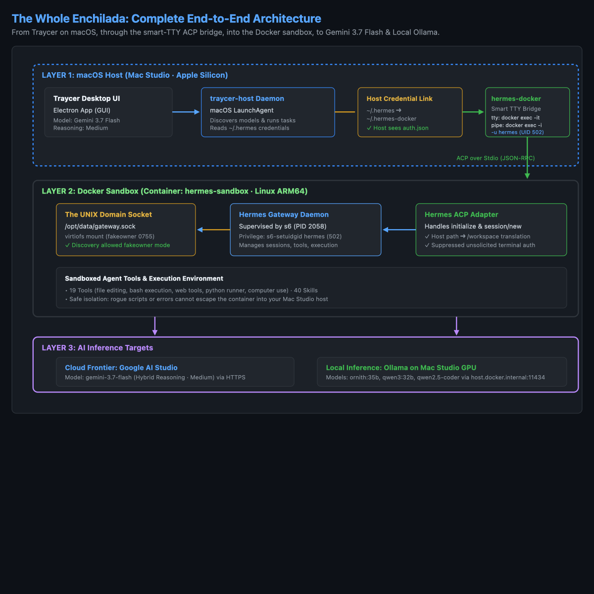

# AgentJail: Hermes Docker Sandbox Bridge for macOS & Traycer

> **Run Hermes Agent securely inside a Docker sandbox while controlling it through Traycer on macOS — with zero permission errors, non-root security, and instant Apple Silicon / Gemini 3.7 Flash support.**



---

## The Problem

Autonomous coding agents (like Hermes, Claude Code, and Codex) have terminal and filesystem privileges. Running them natively on your Mac gives an autonomous LLM root-level access to your personal files, SSH keys, credentials, and local network.

However, running Hermes inside Docker on macOS historically broke:
1. **The macOS virtiofs Socket Trap:** Docker Desktop on macOS locks AF_UNIX sockets to mode `0755` and rejects `chmod 600` with `EINVAL`. Hermes CLI discovery strictly required `0600`, immediately crashing with `unsafe_control_permissions`.
2. **The Non-Root Privilege Boundary:** `docker exec` defaults to root (UID 0), while Hermes drops privileges to user `hermes` (UID 502), causing `unsafe_control_path` rejections.
3. **The Stdio vs. TTY Protocol Conflict:** Traycer's Agent Client Protocol (ACP) requires raw, unbuffered stdio streaming (`-i`), but interactive terminal setup requires a pseudo-TTY (`-it`).
4. **The Host Workspace Path Mismatch:** Traycer passes host paths (`/Users/...`) that don't exist inside the Linux container.

---

## The Solution: AgentJail Bridge

AgentJail provides a turnkey 1-command installer that:
- Deploys a **smart-TTY ACP wrapper** that auto-detects background JSON-RPC pipes vs. interactive terminal sessions.
- Enforces non-root container execution (`-u hermes`).
- Transparently translates macOS workspace paths to container mounts.
- Connects **Traycer** on macOS to **Hermes Agent** in Docker, powered by **Google Gemini 3.7 Flash** (cloud) and local **Ollama** on Apple Silicon GPU.

---

## Quickstart (1 Command)

```bash
git clone https://github.com/Voltarr/hermes-docker-traycer.git
cd hermes-docker-traycer
./install.sh
```

Then in **Traycer**:
1. Go to **Settings ➔ Providers ➔ Hermes Agent ➔ CLI & Args**.
2. Click **+ Add custom path** and choose:
   `$HOME/bin/hermes-docker`
3. Flip the toggle to **Enabled**.

---

## Bonus Reference
Included in this repo is our [AI Reasoning & Intelligence Levels Cheat Sheet](assets/cheatsheet.png) for choosing optimal reasoning effort across coding models.

---

## License
MIT. Built by Derek (@Voltarr) for GreenlitCrew.
